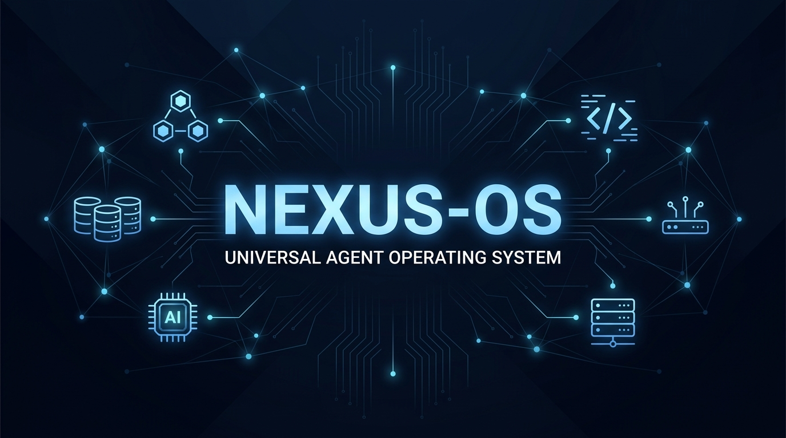

**زبان:** [English](../../README.md) | [اردو](README.md) | [Deutsch](../de-DE/README.md) | [Português (Brasil)](../pt-BR/README.md) | [简体中文](../../README.zh-CN.md) | [繁體中文](../zh-TW/README.md) | [日本語](../ja-JP/README.md) | [한국어](../ko-KR/README.md) | [Türkçe](../tr/README.md) | [Русский](../ru/README.md) | [Tiếng Việt](../vi-VN/README.md) | [ไทย](../th/README.md) | [Українська](../uk-UA/README.md)

# NEXUS-OS



[](https://www.npmjs.com/package/nexus-os)
[](https://www.npmjs.com/package/nexus-agentshield)
[](https://nexusos-dev.vercel.app)
[](../../LICENSE)


> **182K+ ستارے** | **28K+ فورکس** | **170+ تعاون کار** | **12+ زبانی ماحولیاتی نظام** | **خود مختار ایجنٹ آپریٹنگ سسٹم**

---

<div align="center">

**زبان / Language / 语言**

[English](../../README.md) | [**اردو**](README.md) | [Deutsch](../de-DE/README.md) | [Português (Brasil)](../pt-BR/README.md) | [简体中文](../../README.zh-CN.md) | [繁體中文](../zh-TW/README.md) | [日本語](../ja-JP/README.md) | [한국어](../ko-KR/README.md) | [Türkçe](../tr/README.md) | [Русский](../ru/README.md) | [Tiếng Việt](../vi-VN/README.md) | [ไทย](../th/README.md) | [Українська](../uk-UA/README.md)

</div>

---

**ایجنٹک کام کے لیے ہارنس-نیٹو آپریٹر سسٹم۔ خود مختار ایجنٹوں کے لیے انٹرپرائز آرکیٹیکچر۔**

صرف کنفیگریشن نہیں۔ ایک مکمل نظام: skills، instincts، میموری آپٹیمائزیشن، مسلسل سیکھنا، سیکیورٹی اسکیننگ، اور research-first ڈیویلپمنٹ۔ مہینوں کے گہرے روزانہ استعمال سے تیار کیے گئے پروڈکشن-ریڈی agents، skills، hooks، rules، MCP کنفیگریشن، اور legacy command shims۔

**Claude Code**، **Codex**، **Cursor**، **OpenCode**، **Gemini**، **Zed**، **GitHub Copilot**، اور دیگر AI ایجنٹ ہارنسز پر کام کرتا ہے۔

NEXUS-OS v2.0.0-rc.1 اس قابل استعمال پرت پر عوامی Hermes آپریٹر کہانی شامل کرتا ہے: [Hermes سیٹ اپ گائیڈ](../../docs/HERMES-SETUP.md) سے شروع کریں، پھر [rc.1 ریلیز نوٹس](../../docs/releases/2.0.0-rc.1/release-notes.md) اور [کراس-ہارنس آرکیٹیکچر](../../docs/architecture/cross-harness.md) دیکھیں۔

---

<table>
<tr>
<td width="25%" align="center">
  <a href="https://nexusos-dev.vercel.app">
    <strong> NEXUS-OS Pro</strong><br />
    <sub>نجی ریپوز · GitHub App · $19/نشست/ماہ</sub>
  </a>
</td>
<td width="25%" align="center">
  <a href="https://github.com/sponsors/nexus-os-team">
    <strong> اسپانسر</strong><br />
    <sub>OSS کو فنڈ کریں · $5/ماہ سے</sub>
  </a>
</td>
<td width="25%" align="center">
  <a href="https://github.com/doodleino/nexus-os/discussions">
    <strong> کمیونٹی</strong>
    <br />
    <sub>Discussions · Q&amp;A · Show & Tell</sub>
  </a>
</td>
<td width="25%" align="center">
  <a href="https://nexusos-dev.vercel.app">
    <strong> GitHub App</strong><br />
    <sub>انسٹال · PR آڈٹس · مفت ٹیئر</sub>
  </a>
</td>
</tr>
</table>

<sub>**OSS مفت رہتا ہے۔** یہ ریپو ہمیشہ کے لیے MIT لائسنس یافتہ ہے۔ NEXUS-OS Pro نجی ریپوز کے لیے ہوسٹڈ GitHub App ہے۔ <a href="https://github.com/sponsors/nexus-os-team">اسپانسرز</a> اور <a href="https://nexusos-dev.vercel.app">Pro سبسکرائبرز</a> اس کام کو فنڈ کرتے ہیں۔</sub>

---

## گائیڈز

یہ ریپو صرف خام کوڈ ہے۔ گائیڈز سب کچھ سمجھاتے ہیں۔

| موضوع | آپ کیا سیکھیں گے |
| ----- | --------------- |
| ٹوکن آپٹیمائزیشن | ماڈل سلیکشن، سسٹم پرامپٹ کم کرنا، بیک گراؤنڈ پراسیسز |
| میموری پرسسٹنس | ہکس جو سیشنز کے دوران سیاق و سباق محفوظ/لوڈ کرتے ہیں |
| مسلسل سیکھنا | سیشنز سے پیٹرنز خودکار طریقے سے نکالنا |
| تصدیقی لوپس | Checkpoint بمقابلہ مسلسل evals، grader کی اقسام |
| Parallelization | Git worktrees، cascade طریقہ، کب instances بڑھائیں |
| Subagent آرکیسٹریشن | سیاق و سباق کا مسئلہ، iterative retrieval پیٹرن |

---

## فوری آغاز

2 منٹ سے کم میں شروع کریں:

### صرف ایک راستہ منتخب کریں

زیادہ تر Claude Code صارفین کو صرف ایک انسٹال راستہ استعمال کرنا چاہیے:

- **تجویز کردہ ڈیفالٹ:** Claude Code پلگ ان انسٹال کریں، پھر صرف وہ rule فولڈرز کاپی کریں جو آپ واقعی چاہتے ہیں۔
- **دستی انسٹالر صرف تب استعمال کریں** جب آپ مزید کنٹرول چاہتے ہوں۔
- **انسٹال طریقے ملائیں نہیں۔** سب سے عام خراب سیٹ اپ یہ ہے: پہلے `/plugin install`، پھر `install.sh --profile full`۔

### مرحلہ 1: پلگ ان انسٹال کریں (تجویز کردہ)

```bash
# مارکیٹ پلیس شامل کریں
/plugin marketplace add https://github.com/doodleino/nexus-os

# پلگ ان انسٹال کریں
/plugin install nexus-os@nexus-os
```

### مرحلہ 2: Rules انسٹال کریں (اگر ضرورت ہو)

```bash
# ریپو کلون کریں
git clone https://github.com/doodleino/nexus-os.git
cd nexus-os

# NEXUS-owned نیم اسپیس میں rules کاپی کریں
mkdir -p ~/.claude/rules/nexus
cp -R rules/common ~/.claude/rules/nexus/
cp -R rules/typescript ~/.claude/rules/nexus/  # اپنی زبان منتخب کریں
```

### مرحلہ 3: استعمال شروع کریں

```bash
# Skills بنیادی workflow سطح ہیں
/nexus:plan "یوزر تصدیق شامل کریں"

# دستیاب commands چیک کریں
/plugin list nexus-os@nexus-os
```

**بس!** آپ کو اب 61 agents، 246 skills، اور 76 legacy command shims تک رسائی حاصل ہے۔

### Dashboard GUI

```bash
npm run dashboard
# یا
python3 ./nexus_dashboard.py
```

---

## اندر کیا ہے

یہ ریپو ایک **Claude Code plugin** ہے — براہ راست انسٹال کریں یا اجزاء دستی طور پر کاپی کریں۔

```
NEXUS-OS/
├── agents/           # 60 مخصوص subagents
├── skills/           # Workflow تعریفیں اور ڈومین علم
├── commands/         # Slash-entry compatibility
├── rules/            # ہمیشہ پیروی کرنے والی ہدایات
├── hooks/            # Trigger-based آٹومیشن
├── scripts/          # Cross-platform Node.js اسکرپٹس
└── tests/            # ٹیسٹ سوئٹ
```

---

## کون سا Agent استعمال کروں؟

| میں چاہتا ہوں... | یہ سطح استعمال کریں | Agent |
| --------------- | ------------------- | ----- |
| نئی feature منصوبہ بنانا | `/nexus:plan "Auth شامل کریں"` | planner |
| سسٹم آرکیٹیکچر ڈیزائن | `/nexus:plan` + architect agent | architect |
| پہلے ٹیسٹ کے ساتھ کوڈ لکھنا | `tdd-workflow` skill | tdd-guide |
| لکھے گئے کوڈ کا جائزہ | `/code-review` | code-reviewer |
| ناکام build ٹھیک کرنا | `/build-fix` | build-error-resolver |
| سیکیورٹی کمزوریاں تلاش کرنا | `/security-scan` | security-reviewer |
| غیر ضروری کوڈ ہٹانا | `/refactor-clean` | refactor-cleaner |
| دستاویزات اپ ڈیٹ | `/update-docs` | doc-updater |
| Python کوڈ جائزہ | `/python-review` | python-reviewer |

---

## AgentShield — سیکیورٹی آڈیٹر

AI ایجنٹوں کے لیے انٹرپرائز سیکیورٹی آڈیٹر۔ 1282 ٹیسٹ، 98% کوریج، 102 static analysis rules۔

```bash
# فوری اسکین (کوئی انسٹال ضروری نہیں)
npx nexus-agentshield scan

# محفوظ مسائل خودکار طریقے سے ٹھیک کریں
npx nexus-agentshield scan --fix

# تین Opus 4.6 agents کے ساتھ گہرا تجزیہ
npx nexus-agentshield scan --opus --stream
```

**یہ کیا اسکین کرتا ہے:** CLAUDE.md، settings.json، MCP configs، hooks، agent تعریفیں، اور skills — 5 زمروں میں: secrets detection (14 patterns)، permission آڈیٹنگ، hook injection تجزیہ، MCP server risk profiling، اور agent config جائزہ۔

---

## ضروریات

- **Claude Code CLI v2.1.0 یا بعد کا ورژن**

```bash
# اپنا ورژن چیک کریں
claude --version
```

---

## ٹیسٹ چلانا

```bash
# تمام ٹیسٹ چلائیں
node tests/run-all.js
```

---

## تعاون

**تعاون کا خیر مقدم اور حوصلہ افزائی کی جاتی ہے۔**

اگر آپ کے پاس یہ ہیں تو براہ کرم تعاون کریں:
- مفید agents یا skills
- ہوشیار hooks
- بہتر MCP کنفیگریشن
- بہتر rules

تفصیلات کے لیے [CONTRIBUTING.md](../../CONTRIBUTING.md) دیکھیں۔

### تعاون کے لیے خیالات

- زبان-مخصوص skills (Rust، C#)
- فریم ورک-مخصوص configs (Rails، FastAPI)
- DevOps agents (Kubernetes، Terraform، AWS)
- ٹیسٹنگ حکمت عملی
- ڈومین-مخصوص علم (ML، data engineering)

---

## کراس-پلیٹ فارم سپورٹ

یہ پلگ ان **Windows، macOS، اور Linux** کو مکمل طور پر سپورٹ کرتا ہے، ساتھ ہی بڑے IDEs (Cursor، Zed، OpenCode) اور CLI ہارنسز کے ساتھ تنگ انضمام۔ تمام hooks اور اسکرپٹس زیادہ سے زیادہ مطابقت کے لیے Node.js میں دوبارہ لکھے گئے ہیں۔

---

## Hook Runtime Controls

```bash
# Hook strictness پروفائل (ڈیفالٹ: standard)
export NEXUS_HOOK_PROFILE=standard

# مخصوص hooks عارضی طور پر غیر فعال کریں
export NEXUS_DISABLED_HOOKS="pre:bash:tmux-reminder,post:edit:typecheck"

# SessionStart کے لیے سیاق و سباق محدود کریں
export NEXUS_SESSION_START_MAX_CHARS=4000

# SessionStart سیاق و سباق مکمل طور پر غیر فعال کریں
export NEXUS_SESSION_START_CONTEXT=off
```

---

## عام سوالات

**میں کیسے چیک کروں کہ کون سے agents/commands انسٹال ہیں؟**
```bash
/plugin list nexus-os@nexus-os
```

**میری hooks کام نہیں کر رہیں / "Duplicate hooks file" errors آ رہی ہیں**

`.claude-plugin/plugin.json` میں `"hooks"` فیلڈ شامل **نہ کریں**۔ Claude Code v2.1+ خودبخود `hooks/hooks.json` لوڈ کرتا ہے۔

**کیا میں NEXUS-OS کو صرف کچھ اجزاء کے ساتھ استعمال کر سکتا ہوں؟**

ہاں۔ Option 2 (دستی انسٹالیشن) استعمال کریں اور صرف جو ضرورت ہو کاپی کریں:
```bash
# صرف agents
cp agents/*.md ~/.claude/agents/

# صرف rules
mkdir -p ~/.claude/rules/nexus/
cp -r rules/common ~/.claude/rules/nexus/
```

**کیا یہ Cursor / OpenCode / Codex کے ساتھ کام کرتا ہے؟**

ہاں۔ NEXUS-OS کراس-پلیٹ فارم ہے — Claude Code، Cursor، OpenCode، Codex، GitHub Copilot، Gemini، Zed، اور مزید کے ساتھ۔

---

## لائسنس

MIT لائسنس — دیکھیں [LICENSE](../../LICENSE)
